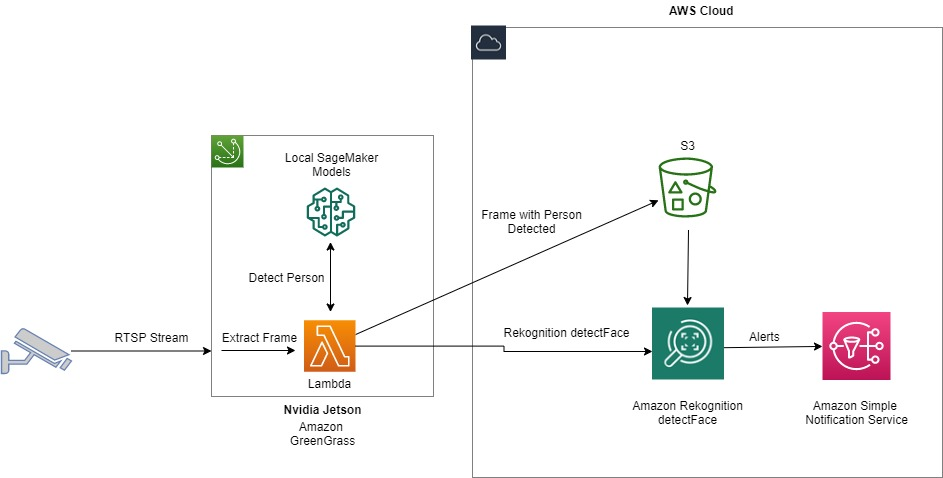

# CV at Edge with Rekognition

A comprehensive computer vision solution for edge deployment on NVIDIA Jetson devices with AWS cloud integration.



## Overview

This project provides two deployment options for computer vision at the edge:

1. **Edge-First Inference** (NEW): Run object detection directly on Jetson devices using TensorRT/ONNX, with results published to AWS IoT Core
2. **Cloud-Based Inference**: Upload frames to S3 and process with AWS Rekognition via Step Functions

## Architecture

### Edge Architecture (Recommended)

```
┌─────────────────────────────────────────────────────────────────┐
│                    JETSON EDGE DEVICE                           │
│  ┌─────────────┐    ┌─────────────┐    ┌─────────────────────┐ │
│  │ Camera      │ -> │ TensorRT    │ -> │  IoT Publishing     │ │
│  │ (CSI/USB/   │    │ YOLOv8      │    │  - Detection Results│ │
│  │  RTSP)      │    │ Inference   │    │  - Device Shadow    │ │
│  └─────────────┘    └─────────────┘    └─────────────────────┘ │
└─────────────────────────────────────────────────────────────────┘
                              │ MQTT
                              ▼
┌─────────────────────────────────────────────────────────────────┐
│                       AWS CLOUD                                 │
│  ┌──────────────┐    ┌──────────────┐    ┌──────────────────┐  │
│  │ IoT Core     │ -> │ IoT Rules    │ -> │ Lambda/Dashboard │  │
│  └──────────────┘    └──────────────┘    └──────────────────┘  │
└─────────────────────────────────────────────────────────────────┘
```

### Cloud Architecture (Fallback)

```
┌───────────────┐     ┌───────────────┐     ┌─────────────────────┐
│ Edge Device   │ --> │ S3 Bucket     │ --> │ Step Functions      │
│ (Frame Upload)│     │               │     │ - Rekognition       │
└───────────────┘     └───────────────┘     │ - IoT Publish       │
                                            └─────────────────────┘
```

## Features

- **Local Edge Inference**: TensorRT-optimized YOLOv8 on Jetson devices
- **Multiple Inference Backends**: TensorRT, ONNX Runtime, TensorFlow Lite
- **Video Source Flexibility**: CSI cameras, USB cameras, RTSP streams, video files
- **AWS IoT Integration**: Real-time MQTT publishing with device shadow
- **Occupancy Detection**: Track vehicle presence with configurable ROI and IoU thresholds
- **State Management**: Hysteresis-based state tracking to prevent flickering
- **Cloud Fallback**: AWS Rekognition-based processing for cloud-first deployments
- **Modern Infrastructure**: Python 3.12, ARM64 Lambda, secure IAM policies

## Quick Start

### Edge Deployment (Jetson)

```bash
# Clone repository
git clone <repository-url>
cd cv-at-edge-with-rekognition

# Setup Jetson environment
cd edge
./scripts/setup-jetson.sh --tensorrt

# Configure
cp .env.example .env
# Edit .env with your AWS IoT credentials

# Run
python -m edge.main --config config/config.yaml
```

### Cloud Backend Deployment

```bash
# Deploy SAM stack
cd rekognition-state-machine
sam build
sam deploy --guided
```

## Project Structure

```
cv-at-edge-with-rekognition/
├── edge/                           # Jetson edge application
│   ├── inference/                  # TensorRT/ONNX/TFLite backends
│   ├── pipeline/                   # Video capture and processing
│   ├── iot/                        # AWS IoT client
│   ├── config/                     # Configuration management
│   ├── Dockerfile                  # Container definition
│   └── README.md                   # Edge deployment guide
│
├── rekognition-state-machine/      # AWS SAM serverless backend
│   ├── template.yaml               # SAM/CloudFormation template
│   ├── detect_labels/              # Rekognition Lambda
│   ├── publish_to_topic/           # IoT publish Lambda
│   ├── update_shadow/              # Shadow update Lambda
│   └── generate_presigned_url/     # S3 URL Lambda
│
├── react-ui/                       # React dashboard
│   └── src/
│       └── dashboard/              # Real-time monitoring UI
│
├── simulator/                      # Testing utilities
│   ├── video-processor.py          # Video frame extractor
│   └── s3-uploader.py              # S3 upload simulator
│
└── docs/                           # Documentation and diagrams
```

## Supported Hardware

### Jetson Devices
- Jetson Orin Nano / NX / AGX
- Jetson Xavier NX / AGX Xavier
- Jetson Nano
- JetPack 5.x and 6.x

### Expected Performance

| Device | Model | FPS |
|--------|-------|-----|
| Jetson Nano | YOLOv8n | 15-20 |
| Jetson Xavier NX | YOLOv8s | 30-40 |
| Jetson Orin Nano | YOLOv8s | 40-60 |
| Jetson Orin NX | YOLOv8m | 60-80 |

## Configuration

### Edge Configuration (config.yaml)

```yaml
video:
  source: "0"                    # Camera device
  width: 1280
  height: 720

inference:
  model_path: models/yolov8n.engine
  backend: tensorrt
  confidence_threshold: 0.5

detection:
  target_classes: [truck, car]
  iou_threshold: 0.3
  roi_x1: 0.10
  roi_y1: 0.10
  roi_x2: 0.85
  roi_y2: 0.90

aws:
  iot_endpoint: "xxx.iot.us-east-1.amazonaws.com"
  iot_topic: garage/001/bay/01
```

### Cloud Configuration (SAM Parameters)

```yaml
Parameters:
  Environment: dev
  IoTThingName: JetsonEdgeDevice
  IoTTopic: garage/001/bay/01
```

## Docker Deployment

```bash
# Build
cd edge
docker build -t jetson-edge-cv .

# Run with NVIDIA runtime
docker run --runtime nvidia \
    -v ./models:/app/models \
    -v ./certs:/app/certs \
    --device /dev/video0 \
    --network host \
    jetson-edge-cv
```

## AWS Services Used

- **IoT Core**: MQTT broker for real-time messaging
- **IoT Device Shadow**: Device state synchronization
- **S3**: Frame storage
- **Lambda**: Serverless compute
- **Step Functions**: Workflow orchestration
- **Rekognition**: Cloud-based object detection (fallback)
- **CloudTrail**: Event logging
- **EventBridge**: Event routing
- **CloudWatch**: Monitoring and logging

## Security

- TLS 1.2+ for all AWS communications
- X.509 certificates for IoT device authentication
- Least-privilege IAM policies
- S3 bucket encryption at rest
- No hardcoded credentials

## Contributing

1. Fork the repository
2. Create a feature branch
3. Make your changes
4. Submit a pull request

## License

MIT License - see LICENSE file for details.

## Changelog

### v1.0.0
- Added Jetson edge inference with TensorRT/ONNX support
- Updated Python runtime to 3.12
- Fixed IAM security issues
- Added Docker and docker-compose support
- Modernized dependencies
- Added comprehensive configuration system
